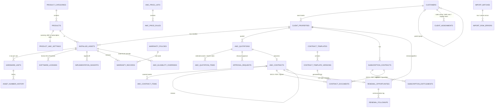

# Samsotech AMC & Contract Management Platform — Phase 0 Assessment

Status: **Draft for business-owner approval.** No application code or database has been changed.
Date: 3 November 2026 · Branch: `ccr-e23736bb-07g1fo`

This document covers the eight Phase 0 deliverables in the master development prompt:

1. Technical assessment
2. Existing functionality inventory
3. Proposed module architecture
4. Proposed database changes (with relationship diagram)
5. Development roadmap
6. Risk assessment
7. Testing strategy
8. Staging and production deployment plan

Section 9 lists the decisions and business rules I need from you. I have not made them up.

---

## 1. Technical assessment

### 1.1 Which application this is

The repository `vishnu807-debug/SMB-TMS` contains a working application called **SMP Trading Management
System**. It is a CRM and mini-ERP built for *SMP General Trading*, a trading company in the UAE. It has no AMC,
installed-asset, warranty or contract features yet.

Your first instruction called the Samsotech platform a *new, independent project*. The master prompt calls it an
*existing project* and says not to rebuild from scratch. The repository is a different company's trading ERP built
on the same technology, so both readings are possible. **Decision D1 in section 9 asks you to settle this.** The
rest of this document assumes my recommendation in section 3.1.

### 1.2 Technology found

| Area | What exists today | Fits the Samsotech requirements? |
| --- | --- | --- |
| Frontend | Next.js 15 (App Router), React 19, TypeScript in strict mode | Yes |
| UI | Tailwind CSS 3, a small home-made component set (button, card, table, badge, input, alert), Lucide icons, charts on the dashboard | Yes. It needs extending: tabs, filters, date pickers, status chips, a data grid |
| Backend | Next.js server actions and route handlers. Every write goes through PostgreSQL `security definer` functions (204 functions) | Yes. This is the "centralised business logic" pattern the prompt asks for |
| Database | Supabase PostgreSQL: 18 version-controlled SQL migrations, about 75 tables and 15 views | Yes |
| Security | Row Level Security on every table. The `has_permission()` check runs inside the database, so a hidden button is never the only protection | Yes |
| Authentication | Supabase Auth (email and password). Admins invite users, self sign-up is off. Includes lock-out after failed attempts, password reset, forced password change, session revocation and an auth-event log | Yes |
| Authorisation | 12 roles, a permission catalogue, a role-to-permission matrix and per-user extra or denied permissions | Yes. Needs new AMC roles and permissions |
| Validation | Zod 4 | Yes |
| Documents | `@react-pdf/renderer` builds PDFs from code (quotations, invoices, purchase orders, delivery notes) | **Partly.** Samsotech needs **Word-template** contracts, which is a new capability (see 3.5) |
| Import | Excel and CSV import with an `import_batches` table, used for customers and enquiries | Partly. It needs a column-mapping step, a preview step and row/column error reports |
| Files | Supabase Storage with private buckets | Yes |
| Scheduled jobs | Vercel Cron calls `/api/cron/daily` with a secret | Yes. It can run the renewal and notification engine |
| Integrations | UAE e-invoicing (PINT AE) connector through an accredited service provider | Not needed for AMC |
| Licensed modules | A vendor console turns whole modules on or off for each installation | **Useful.** AMC and Subscriptions can be added as licensed modules |
| Tests | 10 SQL behaviour-test files that rebuild a scratch database and check business rules and permissions. **No Vitest, no Playwright** | Partly. Unit, integration and browser tests must be added |
| CI/CD | GitHub Actions: typecheck, migration lint, build and SQL tests. A second workflow **pushes migrations to the live Supabase database automatically after every merge to `main`.** Vercel deploys the app | **Needs changing** before AMC work merges (see 1.4) |

### 1.3 Verified in this session

* `npm ci` and `npm run typecheck`: pass.
* `scripts/check-migrations.mjs`: pass.
* `npm run db:test` on a fresh PostgreSQL 16 database: **all 18 migrations apply and all 10 behaviour-test suites pass.**
* **Not verified:** `next build`, the live Vercel deployment and the live Supabase project. I have no credentials for
  them and did not try to reach them.

### 1.4 Findings that matter before any development

1. **There is one environment, and it is effectively production.** Merging to `main` (a) applies new migrations
   to the live database straight away and (b) lets Vercel deploy `main` to the live site. That breaks Rule 3, which
   says nothing may go live without your approval. A staging environment and a manual production release step must
   exist **before** the first AMC migration is merged (Phase 1, step 1).
2. **Shared tables.** `customers`, `products`, `product_categories`, `profiles`, `roles`, `audit_log` and
   `notifications` are used by every module. AMC changes to them must be **additive only**: new columns that can be
   empty, and new tables. The SMP test suite must pass after every phase.
3. **The customer model has no hotel or property level.** A customer has addresses, but a client cannot own
   several hotels, and there are no "AMC executive" or "support team" assignments.
4. **The product model is built for trading** (stock, reorder levels). It has no warranty duration, AMC eligibility,
   AMC pricing method or subscription eligibility.
5. **The existing quotation module prices goods** (cost, margin, delivery). AMC quotations price *installed assets
   over a contract period*. They need their own tables, while reusing the approval engine, document numbering and
   PDF helpers.

---

## 2. Existing functionality inventory

| Module | Main features | Data to preserve |
| --- | --- | --- |
| Sales & CRM | Customers (TRN, credit limit, contacts, addresses), leads and enquiries, follow-ups, quotations with revisions, margin control, approvals, PDF, sales orders, sales dashboard | Every customer, lead, quotation and order |
| Products & inventory | Product master, category tree, warehouses, stock ledger, goods received notes, issues, transfers, adjustments, reservations, valuation | Products, categories, stock ledger |
| Procurement | Suppliers, requisitions, supplier quotations, purchase orders, receiving | All |
| Logistics | Delivery notes, shipments, proof of delivery | All, including proof-of-delivery files |
| Finance | Tax invoices, credit notes, receipts, receivables ageing, supplier bills (three-way match), payments, expenses, VAT summary, e-invoicing queue | All. These are legal financial records |
| Administration | 12 roles, permission matrix, per-user grants and denials, user admin, approvals inbox, audit log, settings, branding, vendor console, licensed modules | Users, roles, audit log |

**Reusable for Samsotech without rewriting:** sign-in and user management, roles and permissions, the audit log,
notifications, the approvals engine (`approval_rules`, `approval_requests`), document numbering
(`document_sequences`), the import framework, the PDF helpers, branding, licensed modules, the cron endpoint,
the app layout and navigation, and the CI pipeline.

---

## 3. Proposed module architecture

### 3.1 Recommendation: one codebase, a separate Samsotech installation

Build AMC and Subscriptions as **new licensed modules inside this codebase**. Run Samsotech as **its own
installation**: its own Supabase project (database, logins, files) and its own Vercel site. SMP's data and site
are never shared with or touched by Samsotech.

**Why I recommend this**

* It follows the master prompt: no rebuild from scratch.
* About a third of the work already exists and is tested: authentication, permissions, audit, approvals,
  numbering, import and notifications.
* The security model, with rules enforced inside the database, is already proven.
* Samsotech can switch off the trading modules it does not use (inventory, procurement, logistics) with the
  licensed-modules switch.

**Trade-off:** shared tables carry trading-specific columns that Samsotech does not use. These are harmless and
can be hidden in the screens.

**Alternatives**

| Option | When it is better | Cost |
| --- | --- | --- |
| B. Brand-new separate repository, copying the foundation code | Samsotech must have its own codebase, for example for ownership or IP reasons | About 2–3 extra weeks. Two codebases to maintain from then on |
| C. Add AMC into SMP's live installation (shared database) | Only if Samsotech *is* SMP, or the same company | **Not recommended** otherwise. It mixes two companies' client data |

### 3.2 Design principles

1. **Single source of truth.** A client, hotel, product, asset or contract is stored once. Every screen and
   dashboard reads the same rows.
2. **Business logic in one place: the database.** Warranty dates, eligibility, coverage percentage, ideal AMC
   value, discount percentage and approval need are calculated by PostgreSQL functions and views
   (`amc_coverage(...)`, `amc_ideal_value(...)`, and so on).
   * Every dashboard, quotation, contract and report calls the same function.
   * The browser only displays the results. It never decides a price or an approval.
3. **History is never overwritten.**
   * Changes create new versions or correction records.
   * Signed contracts are locked by a database trigger.
   * Approved quotations keep a copy of the price-list rates they used.
   * Rows are never deleted. They are cancelled, deactivated or superseded.
4. **Permission checks happen twice.** The screens check permissions, and the database checks them again through
   Row Level Security and the write functions.
5. **Everything sensitive is audited:** who, what, when, old value and new value.

### 3.3 Modules (the master prompt's 25 modules → building blocks)

| # | Module | Built on |
| --- | --- | --- |
| 1 | Client / Hotel Master | Existing `customers` plus a new `client_properties` table (hotels) and an optional parent-group link |
| 2 | Product & Category Master | Existing `products` and `product_categories` plus AMC and warranty settings in new linked tables |
| 3 | Installed Asset Register | New: `installed_assets` (one row per sold line) |
| 4 | Hardware Asset Numbers | New: `hardware_units` (one row per physical unit) and `asset_number_history` |
| 5 | Bulk Import | Extend the existing import framework: mapping, validation, preview, error report |
| 6 | Implementation Sign-Off | New: `implementation_signoffs` |
| 7 | Warranty Engine | New: `warranty_policies`, `warranty_records` and database functions |
| 8 | AMC Eligibility Engine | New: product rules, asset overrides and a central eligibility function |
| 9 | Coverage Calculation | Database views and functions, reused by every dashboard |
| 10 | Revenue Forecasting | Database functions over pricing rules and contracts |
| 11 | Renewal Management | New: `renewal_opportunities`, follow-ups and the daily cron |
| 12 | AMC Quotations | New: `amc_quotations` and their lines, using the existing approvals engine |
| 13 | Subscriptions | New: subscription contracts and entitlements |
| 14 | Contract Templates | New: `contract_templates` with versions, kept in private storage |
| 15–16 | AMC and Subscription Contracts | New: contract tables plus a DOCX/PDF generator |
| 17 | Discount Approval | Existing approvals engine plus new AMC rules |
| 18–21 | Dashboards | New pages that read the central database functions |
| 22 | Notification Centre | Existing `notifications` plus configurable milestones |
| 23 | Audit Trail | Existing `audit_log`, extended to the new tables |
| 24 | Users & Permissions | Existing, plus new AMC roles and permissions |
| 25 | Reports & Excel export | The existing Excel writer plus new report definitions |

### 3.4 Proposed new roles (to confirm, decision D4)

| Role | Purpose |
| --- | --- |
| AMC Manager | Runs the AMC team, approves discounts up to their limit, sees all AMC data |
| AMC Executive | Works their assigned clients and renewals, prepares quotations and contracts |
| Support Manager / Support Engineer | Read-only view of the asset register and coverage for support decisions |
| Implementation Engineer | Records implementation sign-offs |
| Contract Administrator | Manages templates and records signed contracts |
| Management (existing Managing Director) | Approves discounts above 5 %, sees the management dashboard |

The existing Super Administrator and Sales roles are kept.

### 3.5 Contract documents (Word → PDF)

* **Filling in the template:** `docxtemplater`, a widely used open-source library, fills placeholders such as
  `{client_legal_name}` and repeating table rows such as covered asset numbers. Formatting, headers, footers and
  branding are kept.
* **Converting to PDF:** this needs LibreOffice, which cannot run on Vercel's servers.

| Option | Data leaves your systems? | Approximate cost | Recommendation |
| --- | --- | --- | --- |
| **Gotenberg**: a free, open-source LibreOffice conversion service in a small private container (Google Cloud Run or Fly.io, Frankfurt region) | No, it is your own service | About US$0–15 per month at your volumes | **Recommended** |
| A paid conversion service (CloudConvert or ConvertAPI) | Yes. Contracts go to a third party | About US$10–50 per month | Only if you prefer no infrastructure at all |
| Move the whole app from Vercel to a container host | No | Similar, but more work and a bigger change | Not now |

The generated DOCX, the PDF, the template version used and a fingerprint (SHA-256 hash) of each file are stored
for every contract.

---

## 4. Proposed database changes

All changes are **additive**. Shared tables only gain new columns that can be empty.

### 4.1 Relationship diagram

### 4.2 Key tables by phase

| Phase | New tables (or new columns on existing tables) | Integrity rules enforced by the database |
| --- | --- | --- |
| 1 | `client_properties`, `client_assignments`; `customers.parent_customer_id`; `product_amc_settings`; `installed_assets`; `hardware_units`; `software_licenses`; `asset_number_history`; `asset_number_formats`; `import_row_errors` | One Samsotech asset number per unit, unique across the company and never reused. Manufacturer serial unique per product. The original sale line is kept even when later corrected. Asset quantity must equal the number of hardware units once all units are registered |
| 2 | `implementation_signoffs`, `warranty_policies` (duration, end-date rule), `warranty_records` (versioned: original, extension, correction with reason and approver) | Warranty dates are only ever produced by the warranty function. A manual exception needs a reason and an authorised user. No silent edits |
| 3 | `amc_eligibility_overrides`, `amc_price_lists`, `amc_price_rules`; views `v_asset_amc_status`, `v_amc_coverage_*` | One price list in effect at a time. Price rules are never edited after use; a new version is created instead |
| 4 | `renewal_opportunities`, `renewal_followups`, `notification_milestones`, `notification_log` | **One open renewal per contract or uncovered asset group** (unique index). Each notification is sent once per milestone (unique key) |
| 5 | `amc_quotations`, `amc_quotation_items` (selected units and rates **copied at the time of quoting**), plus AMC approval rules | Discount and approval need are calculated in the database. Any change to an approved quotation sends it back for approval |
| 6 | `contract_templates`, `contract_template_versions`, `amc_contracts`, `amc_contract_items`, `subscription_contracts`, `subscription_entitlements`, `contract_documents`, `contract_status_history` | **No asset in two active AMC contracts for overlapping dates** (a PostgreSQL exclusion constraint). Signed contracts and their documents cannot be changed. Only a *signed* contract changes official coverage. Subscription and AMC entitlements are kept apart so nothing is counted twice |

Money is stored as exact decimals with a currency code. Dates are stored as calendar dates; times use the UAE time
zone where it matters.

---

## 5. Development roadmap

Each phase follows the 10-step cycle in Rule 2 and ends with a completion report. **I stop and wait for your
approval after every phase.** The durations are rough estimates of my working time. Your review time is extra.

| Phase | Scope (from the master prompt) | Depends on | Estimate |
| --- | --- | --- | --- |
| 0 | This assessment | — | Done, awaiting approval |
| 1 | **Foundations, then** Client/Hotel Master, Product Master extensions, Installed Asset Register, Hardware Asset Numbers, Bulk Import wizard. *Foundation steps first:* create the staging environment, make production releases manual, add Vitest and Playwright, add the AMC roles and the licensed-module switch | D1–D4, a staging Supabase project | 2–3 weeks |
| 2 | Implementation Sign-Off, Warranty Engine, Warranty Dashboard | Phase 1; rules R1–R3 | 1–1.5 weeks |
| 3 | AMC Eligibility, Coverage Calculation, Revenue Forecasting | Phase 2; rules R4–R7 | 2 weeks |
| 4 | Renewal Management and Notifications | Phase 3 | 1.5 weeks |
| 5 | AMC Quotations and Discount Approval | Phases 3–4; rules R8–R10 | 1.5–2 weeks |
| 6 | Contract Templates, AMC and Subscription Contract Generation, document storage | Phase 5; approved Word templates from you; PDF service (D5) | 2–3 weeks |
| 7+ | Dashboards (AMC, Support, Sales, Management), Reporting and Excel export, hardening, user acceptance testing, go-live | **The master prompt was cut off after section 10.5 ("Signed contracts must not be…").** Please send the rest | To be planned |

---

## 6. Risk assessment

| # | Risk | Impact | Mitigation |
| --- | --- | --- | --- |
| 1 | Auto-deploy to live database and site on merge | **High.** Unapproved changes could go live | Phase 1, step 1: staging first, then a manual, approved production release |
| 2 | Business rules not yet defined (pricing, eligibility, discounts) | High. Wrong money figures | Ask before building (section 9). Use worked examples you sign off as test cases |
| 3 | Quality of existing AMC spreadsheets (duplicate serials, missing sign-off dates) | High. Wrong coverage and revenue figures | The import wizard rejects or flags rows instead of guessing. Do a trial import on staging with a data-cleaning report |
| 4 | Changes to shared tables break SMP modules | Medium | Additive changes only. The full SMP test suite runs on every change |
| 5 | Contract templates not legally reviewed, or placeholders wrong | High (legal) | Templates are activated only by a Contract Administrator after a preview. Contracts are never generated from unapproved data. Legal review is on your side |
| 6 | Word → PDF layout differences | Medium | Test with your real templates early in Phase 6. Keep the DOCX as the master copy |
| 7 | Supabase free tier has no daily backups or point-in-time recovery | High for production | Production on **Supabase Pro** (about US$25 per month, plus point-in-time recovery from about US$100 per month), weekly off-site exports, and a restore test before go-live. Storage files need their own backup |
| 8 | Prompt section after 10.5 is missing | Medium | Please resend before Phase 6 is planned in detail |
| 9 | One developer, and the knowledge sits with that developer | Medium | Written decision log, database reference document and runbooks in `docs/` |

---

## 7. Testing strategy

| Layer | Tool | What it proves | When it runs |
| --- | --- | --- | --- |
| Database behaviour | SQL test suites (existing style, extended) | Warranty, eligibility, coverage, pricing, discount and approval rules. Duplicate prevention. Immutability of signed contracts. **Row Level Security: each role can and cannot see and change the right things** | Every push, in CI |
| Unit | **Vitest** (new) | Import parsing and mapping, validation schemas, date formatting, template placeholder checks | Every push |
| Integration | Vitest against a local Supabase | Server actions call the right database functions; uploaded files land in the right private bucket and other users cannot read them | Every push |
| End-to-end | **Playwright** (new) | Real browser journeys per role: import → sign-off → quotation → approval → contract; screenshots for the phase reports | Every phase; before every release |
| Financial golden tests | SQL and Vitest | Worked examples **you approve** (for example "20 kiosks, 15 renewed, 7 % discount → AED X"). Edge cases: exactly 5 %, leap years, month-ends | Every push |
| Contract generation | Vitest plus a PDF text check | Every placeholder filled, the exact covered asset list appears, the hash is stored, and the template version is recorded | Phase 6 onwards |
| Regression | Existing SMP suites | SMP modules still work | Every push |
| User acceptance | You, on staging | Business sign-off | End of each phase |

---

## 8. Staging and production deployment plan

| Environment | Database / logins / files | Web app | Data | How changes arrive |
| --- | --- | --- | --- | --- |
| Local / CI | Supabase running on the developer machine (Docker) or a scratch PostgreSQL | `next dev` | Generated sample data only, every record marked `SAMPLE-` | Every commit |
| **Staging** | New Supabase project `samsotech-amc-staging` | Vercel preview environment on a fixed staging address, protected by login | Sample data, plus anonymised copies of real data for user acceptance testing if you approve | Automatically after CI passes on `main` |
| **Production** | New Supabase project `samsotech-amc-prod` (Pro plan) | Vercel production domain | Real Samsotech data only | **Only by a manually started release that you approve** (a GitHub "production" environment with a required reviewer). Migrations are dry-run first. Destructive migrations are blocked by a CI check |

Each environment has its own credentials. The service-role key is server-only and is never sent to the browser.
Production keys are never put on a developer machine. Backups: daily (Pro plan) plus point-in-time recovery, a
weekly off-site export of the database and storage, and a documented restore drill before go-live.

> **Impact on the existing SMP installation:** the workflow change in risk 1 also changes how SMP is deployed.
> Its migrations would go to a staging project first, and production would need a manual release. That is safer,
> but it is a change to SMP's process, and it needs your approval (Rule 4).

---

## 9. Decisions and business rules needed

### Needed before Phase 1

* **D1 — Where to build.** Option A (recommended): this codebase, with a separate Samsotech installation.
  Option B: a new, separate repository. Option C: inside SMP's live installation.
* **D2 — Who owns which accounts.** Do you have (or will you create) the Samsotech Supabase staging and production
  projects and the Vercel project, or should I give you step-by-step setup instructions?
* **D3 — The SMP deployment change** described in section 8: approve or decline.
* **D4 — Roles.** Confirm or adjust the AMC roles in section 3.4.
* **R0 — Client hierarchy.** Is the hierarchy *Group → Client (legal entity) → Hotel*, or only *Client → Hotel*? Is
  the TRN held per legal entity or per hotel?

### Needed before the phase shown (I will ask one at a time when we reach it)

| Ref | Phase | Question |
| --- | --- | --- |
| R1 | 2 | Warranty end date: the anniversary date or the day before? (Example: sign-off 15 Mar 2026 → 15 Mar 2027 or 14 Mar 2027?) |
| R2 | 2 | Sign-off for 29 Feb or 31 Jan with a 1-month duration: does the end date roll back to the month-end? |
| R3 | 2 | Who may record a warranty exception or extension, and does it need a second approver? |
| R4 | 3 | Software coverage: per licence quantity or per individual licence ID? Is this set per product? |
| R5 | 3 | Does an asset under warranty count in "Total Eligible Assets" for coverage, or only after warranty ends? |
| R6 | 3 | Pricing: rates per product or category, the percentage basis (original selling price or current list price), and how the hotel minimum is applied |
| R7 | 3 | Currency (AED only?) and VAT treatment on AMC values |
| R8 | 5 | The full-coverage discount percentage, and whether it adds to other discounts or is capped with them |
| R9 | 5 | The "team approval policy" for discounts of 5 % or less: who approves, or is it automatic? |
| R10 | 5 | Do management approval limits have more than one tier (for example above 15 % goes to the Managing Director)? |
| R11 | 6 | The approved AMC and subscription Word templates, and the contract numbering format |

---

## Next step

Approve this approach, or tell me what to change, and answer D1–D4 and R0. I will then start Phase 1 and begin
with the safety foundations: the staging environment and the manual production release.
